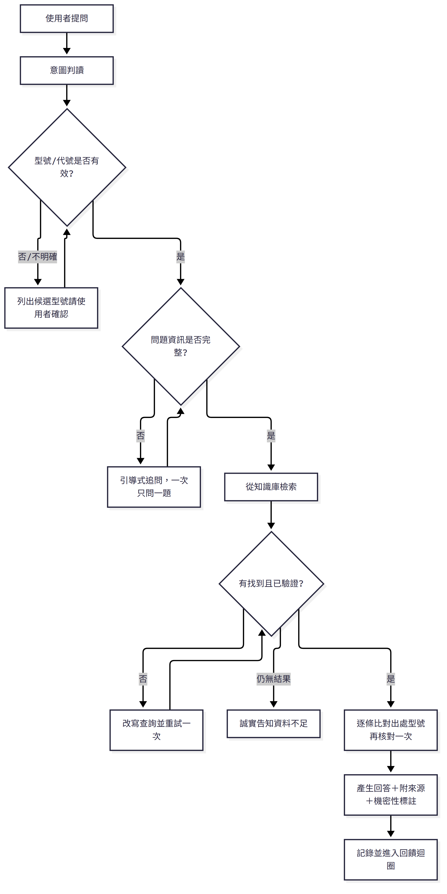
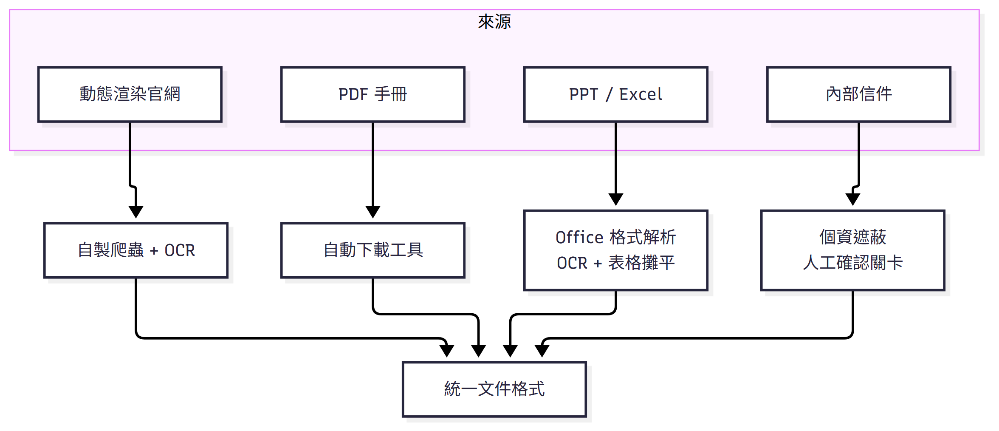
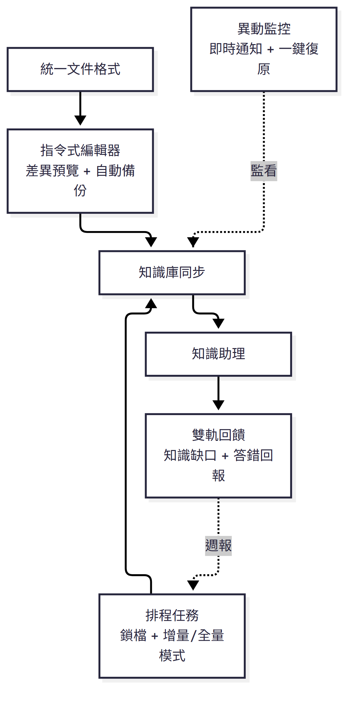
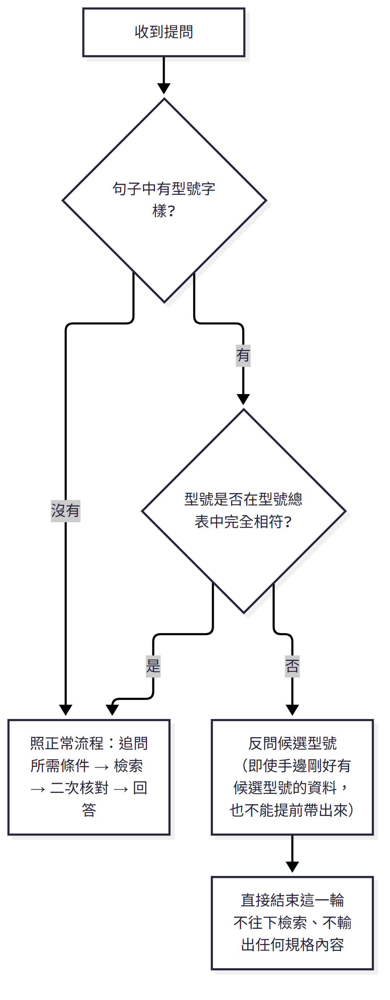
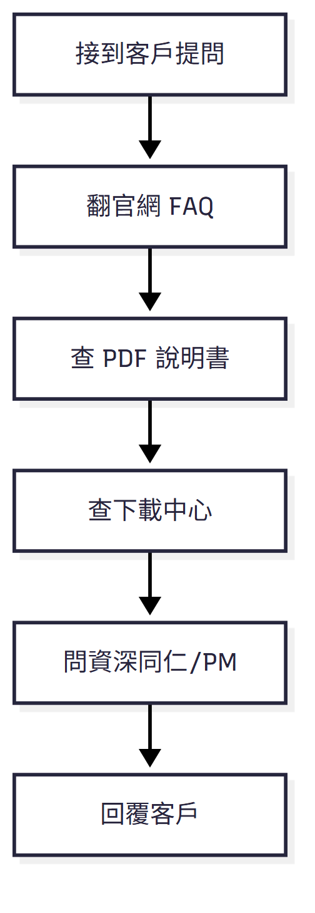
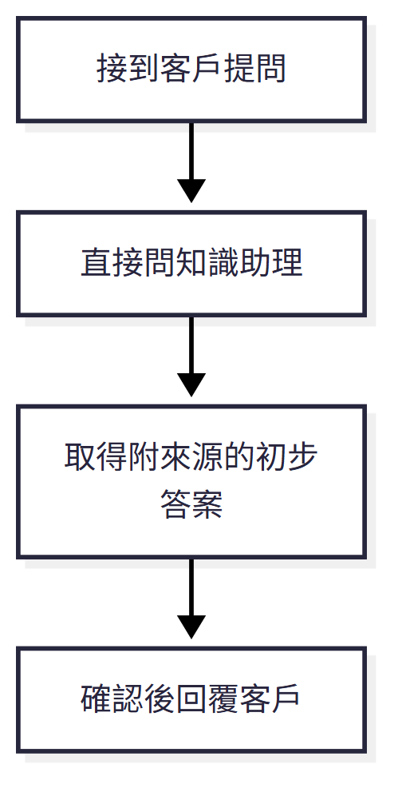

# 企業內部 AI 知識助理

為消費性電子產品客服團隊打造的 AI 知識助理，讓客服與技術人員針對大量產品型號的規格、安裝步驟、故障排除等問題，幾秒內就能拿到可直接引用的正確答案，不用再到處翻官網、PDF 說明書、內部信件找資料。

本專案為現職公司內部系統，僅公開架構設計與工程方法論，不提供原始程式碼與內部系統連結。

**技術棧：** Microsoft Copilot Studio（Generative Orchestration、自訂 Topics、SearchAndSummarizeContent 生成式節點）· GPT-5 Chat（前身為 GPT-4.1）· Power Automate（倒讚建單、知識缺口建單、週報排程、檔案異動通知）· SharePoint（知識庫存放＋語意索引）· Microsoft Teams（通知）· Node.js 自製擷取／轉檔工具（cheerio、turndown、tesseract.js）· Python（python-docx、openpyxl、lxml）＋ PowerShell／pywin32（PPT 轉圖）· Windows 工作排程器（每日定時自動維護）

**個人貢獻範圍：**

| 項目 | 負責程度 |
|---|---|
| 問題定義與需求規劃 | 獨立規劃，基於第一線客服經驗 |
| 對話設計與 prompt 工程 | 獨立設計與撰寫 |
| Copilot Studio 平台功能 | 使用並設定平台原生能力（Generative Orchestration、Topics 等），非自行開發底層引擎 |
| 資料擷取／轉換工具（Node.js、Python） | 獨立開發，採 AI 協作（vibe coding）方式撰寫 |
| 本機維護後台 | 獨立開發 |
| 測試方法設計與執行 | 獨立設計評分標準、建立題庫、執行與複核 |
| 上線後維運與迭代 | 獨立維護 |

---

## 解決的問題

客服人員原本要回答一個問題，得翻官網 FAQ、PDF 操作手冊、PPT 簡報、Excel 規格表、內部信件好幾個地方才能拼湊出答案。消費性電子產品型號眾多、系列與系列之間外觀相近（例如同樣字母代號開頭的系列，光是前綴字母不同就代表完全不同的產品線），一不小心用錯型號的規格回答客戶，就是直接的信任損傷。知識本身也分散在各種標準知識庫爬蟲讀不到的格式裡——JavaScript 動態渲染的官網頁面、PDF 手冊、PPT 簡報裡的示意圖、Excel 比較表、內部信件串。

## 架構

**怎麼回答一個問題：**

**知識怎麼進得來：**

**怎麼維持正確：**

---

## 最高優先的一條規則，決定了其他所有設計

系統裡所有規則中，只有一條被明確標記為「最高優先，凌駕以下所有規則」：**型號比對規則**——不同型號一律視為完全不同的產品，絕不可因為外觀相似、同系列、功能相近就互相套用資料。

這條規則排第一順位不是隨便定的：型號引用錯誤不是「答得不夠好」，是「答案看起來完全正常、使用者根本沒有線索去懷疑」的那種錯誤——語意通順、邏輯合理，唯一的問題是這段資料其實屬於另一支型號，靠人工肉眼抽查幾乎抓不出來，而後果是直接把錯誤規格講給客戶聽。這跟漏答、答得籠統是完全不同等級的風險，所以必須排在所有規則最前面，用結構性的方式擋，而不是寄望模型「這次會小心一點」。

也因為這條規則的優先序最高，它會蓋過當下其他所有判斷，包括「有沒有查到資料」本身——下圖是示意邏輯，非系統原文：

這條「蓋過一切」的優先序，解釋了系統裡幾乎每一個看起來獨立的設計：

- **系統亮點**裡的四層防護（型號總表 → 不直接套用候選 → 輸出前再核對）是直接服務這條規則的三道關卡
- **引導式追問**時，缺型號永遠是第一個要問的條件，不是等所有條件都問完才回頭補問型號
- **查詢改寫重試**時，型號名稱本身一字不能被模型「順手改寫」，只能補齊前綴，其餘口語詞彙才能正常改寫
- **列舉型問題**（例如「哪些型號支援某功能」）額外收緊：只有資料本身就是明確標示型號的對照表才能照列，避免把「型號剛好出現在提到某功能的文件裡」誤判成「該型號支援這個功能」——本質上也是同一條規則的延伸

換句話說，拿掉這一條規則，系統並不會垮掉、答不出話——它會變成一個「答得更快、但偶爾會把 A 型號的答案講成 B 型號」的系統，而這正是客服場景裡代價最高的錯誤類型。這條規則存在的意義，就是把這個風險壓到最低。

---

## 系統亮點

- **嚴格型號比對，不靠相似度猜測**——四層防護（型號總表 → 查無時先反問不直接套用 → 輸出前逐條再核對），避免外觀相近、系列相近的型號被互相套用資料。細節：[`conversation-design/`](conversation-design/)
- **自製資料擷取管線**——針對 JS 動態渲染頁面、PDF、PPT 示意圖、Excel 交叉表各自設計轉換規則，標準知識庫爬蟲讀不到的格式都能進得了知識庫。細節：[`data-pipeline/`](data-pipeline/)
- **指令式編輯 + 並行安全的排程同步**——差異預覽、自動備份、鎖檔機制、即時異動通知與一鍵復原。細節：[`change-management/`](change-management/)
- **雙軌回饋成長迴圈**——「查無資料」與「答錯了」分開追蹤，各自固定週期回報，因為兩者指向完全不同的根因。細節：[`feedback-loop/`](feedback-loop/)

---

## 規模與效益

整合多個產品系列的官網 FAQ、產品說明書、操作文件與圖像知識，建立成一套集中式的 AI 知識查詢系統。

**導入前：**

**導入後：**

原本需要在官網、PDF 說明書、規格表、內部文件之間反覆查找比對，資料來源分散，既耗時、也容易因為跨文件比對疏忽而引用到錯誤型號的資料。導入後改以自然語言直接提問，取得附來源的初步答案，確認後回覆客戶，省去逐一翻找的過程。

**效益方向：**

- **降低資訊引用風險**——型號驗證與來源比對機制，避免不同型號的資料被誤用
- **減少重複查找工作**——知識集中化，同一個問題不用在不同系統裡各查一次
- **知識持續更新**——整合多種文件格式，建立可長期維護的知識管理機制，而不是做完就僵住的靜態資料庫
- **品質持續改善**——測試、使用者回饋、知識缺口追蹤形成閉環，上線不是終點
- **善用既有企業資源**——建置在既有的 Microsoft 365 平台（Copilot Studio、Power Automate、SharePoint）上，不需另外導入新系統

查詢效率、回答正確性、知識覆蓋程度作為內部追蹤指標，持續依實際使用情況調整。

## 方法論與評估

- **防幻覺設計**：型號精準比對、資料不足時主動反問，不自行編造答案；絕對禁止依相似性推測答案，數據類資訊要求逐字引用不可改寫潤飾。
- **知識治理機制**：單一正本來源（SharePoint）、異動即時通知、知識缺口回饋閉環，內部未公開資訊自動加註使用警語。
- **測試與迭代**：建立涵蓋規格查詢、操作設定、故障排除、跨型號比較等情境的測試題庫，上線前反覆迭代優化 prompt 與檢索規則；上線後改以真實客服提問持續追蹤，結果分級記錄並結合使用者回報，識別需要補強的項目。完整的評分標準、測試案例、具體修正紀錄：[`evaluation/`](evaluation/)

## 限制與未來優化方向

**目前限制：**

- 仍需人工維護知識來源的分類與標註規則，尚未做到完全自動化。
- 比較題（跨型號差異）需仰賴額外建立的對照表補強，單純依賴檢索無法一次撈齊完整差異。

**未來規劃：**

- **擴大跨語言支援範圍**，涵蓋海外部門的使用情境，不只是偵測中／英文這兩種。
- **串接內部 ERP／維修查詢系統 API**，讓知識庫以外、散落在其他內部系統裡的資料（例如維修進度、備品狀態）也能被查詢到，而不是只能回答知識庫裡已經整理好的靜態內容。
- **從「查詢」進化到「操作」**：目前的 agent 只能回答問題，規劃讓使用者能直接透過對話下達指令，由 chatbot 代為呼叫後端系統執行操作。這會是角色定位上的跨越——從唯讀的知識助理，變成具備實際操作能力的 agent，連帶也代表〈conversation-design/〉裡「範圍邊界」「防幻覺」那些規則都要重新設計一層：查詢答錯頂多是資訊不準確，操作下錯指令是會真的改到系統資料的，容錯空間完全不同。

## 技術實作範圍

| 層級 | 說明 |
|---|---|
| AI Agent 層 | Microsoft Copilot Studio（Generative Orchestration）建置對話式 Agent，自訂 Topics、SearchAndSummarizeContent 生成式節點、自訂節點指令，設計意圖判讀、型號驗證閘門等對話流程規則；模型由 GPT-4.1 迭代至 GPT-5 Chat |
| 知識庫 | SharePoint Online／OneDrive for Business（文件庫＋清單）作為集中知識來源與語意索引，分類與權限依內部／外部可揭露程度區隔；zh-TW 為主要語言，en-US／en-GB 為次要語言 |
| 自動化流程 | Power Automate cloud flows，涵蓋答錯回報建單、知識缺口追蹤、兩份排程週報、SharePoint 觸發的檔案異動通知，並透過 Teams 推播 |
| 自製資料擷取工具 | Node.js（≥20，ES Modules）開發的爬蟲與格式轉換工具（cheerio 解析＋節流請求、turndown 轉 Markdown、tesseract.js OCR、多模態 LLM 圖說＋快取），產出 Word 檔供知識庫讀取；另建有本機維護後台（Node 原生 REST API＋純網頁），並用 `node --test` 寫測試 |
| 辦公室文件轉換 | Python（python-docx／openpyxl／lxml）解析 Word／Excel／OOXML 結構；PowerPoint 簡報另由 PowerShell＋pywin32 透過 COM 自動化轉圖，再交由 AI Builder 批次整理 |
| 同步與排程 | 以檔案指紋比對差異、衝突不自動覆蓋（sync v2）；Windows 工作排程器＋`.cmd` 批次檔每日上午、下午各定時執行一次自動維護，具鎖檔防重複執行機制 |

## 延伸閱讀

| 檔案 | 內容 |
|---|---|
| [`conversation-design/`](conversation-design/) | 角色與範圍邊界、意圖判讀、型號比對四層防護、引導式追問、防幻覺規則、查詢改寫重試、來源分級標註、語言一致性、三種失敗模式 |
| [`data-pipeline/`](data-pipeline/) | 動態網頁爬蟲技術選型、圖片型內容的視覺擷取＋快取、複雜表格攤平規則、PPT／Excel 辦公室格式轉換、個資遮蔽關卡、自動審核報告、管線工具自身的測試 |
| [`change-management/`](change-management/) | 自建本機維護後台、指令式編輯（差異預覽＋備份）、檔案指紋同步機制、即時異動監控與復原、排程時間與鎖檔並行控制、增量／全量雙模式 |
| [`feedback-loop/`](feedback-loop/) | 知識缺口與答錯回報分軌追蹤、低摩擦回報設計 |
| [`evaluation/`](evaluation/) | 測試流程、5 個真實問題從發現到修正的具體案例、三級評分標準、迭代與追蹤成果、AI 複審流程 |
| [`examples/`](examples/) | 系統匯出的語言偵測 Topic（Copilot Studio 低代碼語法範例，不含業務邏輯或公司資訊） |
