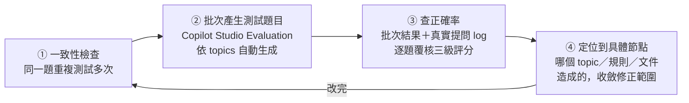

# 測試與評估方式

知識庫 agent 的「對不對」沒辦法像傳統軟體那樣寫單元測試斷言，但也不是隨便問幾句覺得還行就算過——整套流程設計成「大量產生問題 → 批次自動測試 → 人工複核 → 定位問題節點 → 修正 → 再測一次」的迴圈，上線前後各跑一輪、規模不同，而且每一次修正都有具體對應到「改了哪裡、結果差在哪」，不是只看一個總分。

## 測試流程

1. **一致性檢查**：同一個問題重複測試多次，檢查 bot 每次的回答是否一致。只要同一題出現不一致的答案，代表某個 topic 或 instructions 的判斷邏輯有模糊地帶，直接回頭修正，不等它在真實客服場景裡爆出來。
2. **批次產生測試題目**：上線前用 Copilot Studio 內建的 Agent Evaluation 測試集功能（依現有 topics 自動生成題目），建立涵蓋功能、故障排除、韌體、比較題、陷阱題（刻意問不存在的型號）的題庫，一次把 bot 過一輪。
3. **用對話紀錄查正確率**：批次測試與真實客服提問的 log，都拿來逐題覆核，分類成下面的三級評分。
4. **定位到具體節點再修正**：發現答錯或不一致時，不是籠統地「調一下 prompt」，而是先定位是哪個 topic 或 instructions 裡的哪一條規則、或哪一份文件造成的，修正範圍盡量收斂到那個節點。
5. **回到步驟 1 再測一次**：改完不是直接算過關，而是針對同一批題目（含原本測出問題的那幾題）重新測試，確認修正有生效、也沒有連帶弄壞其他原本答對的題目。

## 具體案例：5 個真實問題，從發現到修正

與其只講「消融式驗證」的方法論，不如直接列實際發生過的案例——每一列都是「改之前的真實錯誤 → 根因 → 怎麼修 → 改之後重測的結果」。型號代碼為避免曝光真實產品線，改用虛構代號示意，但字母前綴／後綴造成混淆的機制與案例情境皆為真實發生過的狀況：

| 發現的問題 | 根因 | 怎麼修 | 修正後結果 |
|---|---|---|---|
| 問 A520WT 可以錄多久，卻回答 520 的數據，還附上別台型號的連結 | 型號名稱相近（差一個字母前綴），檢索時混用 | instructions 加入型號辨識規則；每條知識都標註適用型號 | 不再借用他型號資料，資料不足時主動說明，並附上 A520WT 專屬說明書 |
| 問 D760 卻引用 A915XR 的功能 | 簡報轉文字時，把「比較用途」提到的別台型號當成主角存進知識庫 | 修正文件、移除誤植的型號與關鍵字 | 回答只引用正確型號的文件 |
| 比較題（BX10 vs BX20）答不完整 | 兩個型號的差異分散在不同文件裡，單純依賴檢索一次撈不齊 | 額外建立一份「型號差異對照表」 | 完整列出六大差異，不再漏項 |
| 英文提問卻回覆中文 | agent 一開始只設定了繁體中文 | 新增英文語言支援，指示依提問語言回覆 | 英文提問全英文回答 |
| 查不到答案時，沒人知道知識庫缺了什麼 | 沒有回報與追蹤機制，問題憑印象反映，容易被遺忘 | 知識缺口自動記錄＋答錯一鍵回報＋每週固定時段自動彙整週報 | 每週固定掌握缺口，依序排進補件清單 |

這五個案例涵蓋了系統裡四種不同層面的問題——檢索邏輯（第 1、2 題）、知識覆蓋度（第 3 題）、語言設定（第 4 題）、維運機制（第 5 題），修正方式也對應著完全不同的動作（改規則／改文件／補資料／改設定／加流程），不是用同一招打天下。

## 評分標準

建立測試題庫，涵蓋規格查詢、操作設定、故障排除、選購推薦、跨型號比較等各種真實客服會遇到的問法，每一題都人工複核或由 AI 評分，分三級：

| 等級 | 定義 | 評分門檻 |
|---|---|---|
| 正確 | 內容正確完整，且引用型號與使用者所問完全相符 | ≥ 0.9 |
| 部分正確 | 方向正確但缺細節，或明確告知以相近型號參考 | 0.8 – 0.85 |
| 不正確 | 答錯，或借用他型號資料卻未告知 | < 0.8 |

把「型號引用是否相符」直接寫進評分標準裡，而不是只看「答案聽起來對不對」，是因為型號張冠李戴是這類系統最容易出現、也最難靠人工肉眼抽查發現的錯誤類型——評分標準要能逼出這種錯誤，不能只看表面語意是否通順。

**關於「部分正確」這一級的定位**：誠實告知「知識庫查無這筆資料」或「以相近型號參考，明確標示非完全對應」，都歸在部分正確，不是另外開一個未追蹤的類別，也不是不正確——因為這類回答沒有錯誤資訊，只是不完整，跟「編造答案」或「誤用他型號資料卻未告知」是完全不同等級的狀況，評分標準刻意把這兩種情況分開對待。

## 迭代與追蹤成果

這裡呈現兩組**獨立的量測**，分別來自不同階段、不同題庫，彼此不是同一組題目的前後測成績，不適合直接比較解讀：

- **版本迭代測試**（上線前）：以一批題庫反覆迭代優化 prompt 與檢索規則，每輪修正後重新測試，驗證「改了規則之後，同一批題目的表現有沒有變好」，持續看到評分提升的趨勢。
- **上線後實際追蹤**：改用真實客服提問另行評估，AI 自動評分＋人工確認，結果分為正確、部分正確、不正確三級。題目來源、題量、難度分布都跟上線前的測試題庫不同，兩組數字不能直接比較。

**不完全正確的原因分析**：部分正確的案例逐一追根因，結論是**全部都是「知識庫尚未收錄這筆資料」，沒有一筆是 AI 自行編造或瞎猜**——例如型號資料只到 T640WD、沒有 T640W 的版本，agent 誠實說明並以相近型號參考，而不是直接套用 T640WD 的數據當作標準答案。這代表問題全部收斂在「內容覆蓋度」，不是「agent 亂講話」，改善動作可以很明確地聚焦在補文件，而不用去猜是不是哪裡的防幻覺設計失效了。

## 對話設計的複審

對話設計邏輯另外請 AI 工具做過兩輪複審。拿到複審意見後，每一項發現都先回頭對照實際的對話流程邏輯手動重現一次，確認問題真實存在、理解根因之後才決定要不要採納，不是看到建議就照單全收——複審工具能找出盲點，但判斷要不要改、怎麼改，還是要靠自己驗證過一輪。

## 自動化管線的審核機制

資料擷取與轉換這一側，每次自動化跑完都會產生一份審核報告（這次更新了幾筆、哪些需要人工補充、哪些圖片需要進一步解析），讓「自動化做了什麼」隨時可以被檢查，而不是跑完就沒人知道結果對不對。
